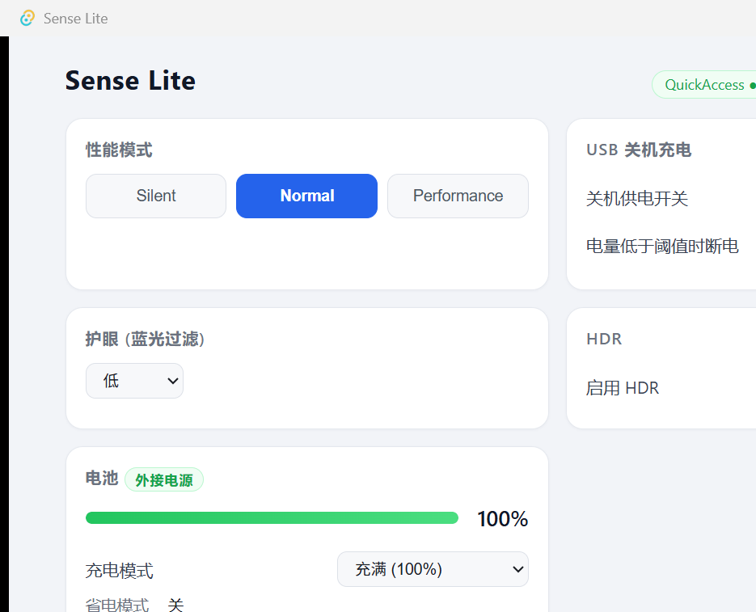

# Sense Lite

**English** | [中文](#中文)

An unofficial, lightweight, open-source control center for Acer laptops on Windows. It talks directly to the local background services that ship with the preinstalled Acer Sense suite, replacing its Electron-based UI with a small native app (~5 MB binary, ~45 MB RAM).

> 基于对 Acer Sense 本地服务协议的逆向工程(见 [docs/PROTOCOL.md](docs/PROTOCOL.md)),仅复用官方后台服务,不打包任何宏碁代码。



## 中文

### 这是什么

宏碁笔记本预装的 Acer Sense 界面臃肿、后台常驻进程多。Sense Lite 把界面整个换掉:用 Tauri 2(Rust + Svelte 5)实现了一个轻量控制中心,直接与系统里已有的宏碁后台服务通信——**不新增任何后台进程**。

- 主程序 **4.9 MB**,运行内存 **~45 MB**(对比:官方 Sense 前端资源就有 121 MB)
- 关闭窗口即最小化到托盘;托盘右键可直接切换性能模式

### 功能(在 Acer Swift 3 SF314-512 上实测)

| 功能 | 说明 |
|---|---|
| 性能模式 | 静音 / 均衡 / 性能,窗口与托盘菜单两处切换 |
| 充电模式 | 充满 (100%) / 优化充电(养护限制);支持 AI 智能充电的机型会自动显示该档 |
| USB 关机充电 | 开关 + 电量阈值(10% / 20% / 30%) |
| 护眼(蓝光过滤) | 6 档 |
| HDR | 开关;面板不支持时自动检测并禁用 |
| 电池状态 | 实时电量、外接电源徽标(AC 插拔实时推送) |
| 设备信息 | 型号 / CPU / 内存 / BIOS / 序列号 |

界面按设备能力表动态显示卡片,不支持的命令自动隐藏或禁用。

### 工作原理

Acer Sense 的官方界面本身也只是本机回环地址上几个后台服务的客户端。Sense Lite 实现了相同的协议:

```
Sense Lite (Tauri) ──wss + JSON──▶ AcerQAAgent :5141(性能/充电/护眼)
                               ──▶ AcerCCAgent :4343(电池)
                               ──▶ AcerDIAgent :4449(设备信息)
```

握手使用 AES-128-ECB 验证(密钥硬编码于官方前端),业务包为明文 JSON。完整的协议规范——包格式、命令表、参数语义、实测记录、坑点(应答式握手、节流、静默丢包)——见 **[docs/PROTOCOL.md](docs/PROTOCOL.md)**。

### 环境要求

- Windows 10 / 11,宏碁笔记本,已安装 Acer Sense 套件(后台服务在运行)
- 从源码构建:Node.js ≥ 18、Rust(MSVC 工具链)、Visual Studio Build Tools

### 构建

```bash
npm install
npm run tauri build      # 产物: src-tauri/target/release/sense-lite.exe
npm run tauri dev        # 开发模式
cargo test               # 协议编解码单元测试(在 src-tauri/ 下)
```

> 直接用 `cargo build --release` 时必须加 `--features custom-protocol`,否则不会打包前端资源。

### 免责声明

- 本项目与 Acer / 宏碁**无任何关联**,Acer Sense 及相关商标归宏碁所有。
- 协议常量(握手密钥等)提取自官方客户端,仅用于实现与本机已安装服务的互操作。
- 本软件按 "现状" 提供,使用风险自负;请勿在不明语义的情况下调用协议文档中标注为高危的接口。

## License

[MIT](LICENSE)
